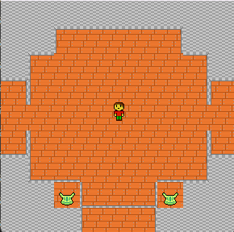
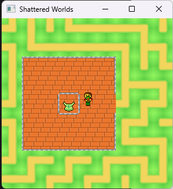
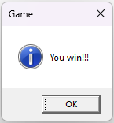

# Игра "Лабиринт"
Небольшой проект, нацеленный на изучения работы с оконными приложениями для Windows.

## Особенности:
* Игра написана с использованием API Windows и Direct2D на C++
* Используется простой алгоритм для генерации лабиринта
* Проект реализован с помощью ООП
* Простая пиксельная графика

## Скриншоты из игры

### Центральная комната 


### Комната в лабиринте


### Экран победы


## Управление:
WASD - Движение  
Z - Взаимодействие

## Структура проекта
### Часть 1:
```
ShatteredEngine
├─── Camera
├─── Window
├─── InputManager
│    └─── PlayerInput
├-─- GameData (Game)
└─── Log
```
### Часть 2:
```
Game
├─── PlayerCharacter
│    └─── CharacterSprite
└─── Level
     ├─── Map
     └─── Tileset
```
## Сборка проекта:
* Настроить компайлер cl.exe (Visual Studio) для работы в VS Code.
* Открыть папку Game через VS Code и запустить отладку.

